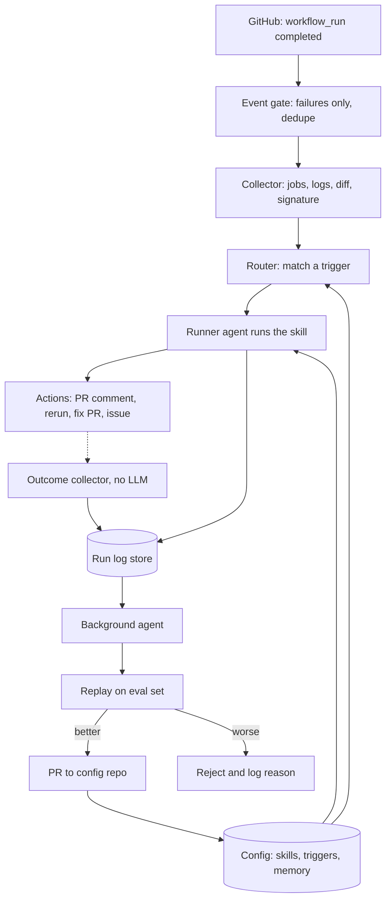

# 🚧 Under construction

# Code Triage agent

## What the system does

When a CI build fails, the **runner agent** reads the logs and decides what kind of failure it is. It then acts: re-runs a flaky test, comments on the PR with the likely cause, or opens a fix PR.

A **background agent** checks how well the runner did and edits the runner's skills, triggers and memory to improve it.

This system helps align the agent's behavior with the associated repositories conventions and styles, makes codes fixes easier to review and work better than a generic code review bot.

(This is inspired from Mintlify's self-updated documentation agent. Read more [here](https://x.com/patrickrfos/status/2116194642417037766))

## Architecture



## Development

Requires [uv](https://docs.astral.sh/uv/) (Python 3.13 is managed by uv).

```bash
cp .env.example .env   # fill in GitHub App values when testing webhooks
uv sync

make check             # ruff + mypy + pytest
make validate          # validate config/triggers.yaml, skills, memory
make serve             # http://localhost:8000/healthz
```

### Phase 1 status

The plumbing path is implemented and needs no LLM:

```bash
# Verify GitHub webhook signatures and store failures (202 in under 5s)
curl -X POST http://localhost:8000/webhooks/github ...

# Process queued events: fetch jobs/logs/diff, trim, redact, sign, snapshot
uv run code-triage-agent worker --once

# Debug one stored event, or import a raw payload for an offline run
uv run code-triage-agent collect --event-id 1
uv run code-triage-agent collect --payload tests/fixtures/github/workflow_run_event.json \
  --repo acme/widgets --run-id 9001
```

Each collected run writes `var/snapshots/<run_id>/` with `metadata.json`,
`logs.txt`, `diff.patch`, `memory.json`, and `signature.txt`. Rows for events,
runs, steps, and signatures live in `var/triage.db`.

### Phase 2 status

The runner is implemented in replay mode: it routes a snapshot to a skill,
runs a bounded tool loop, validates the `submit_triage` decision and evidence,
and renders one idempotent comment. No rerun, issue, or fix-PR action exists.

```bash
# Run the full runner pipeline against a fixture snapshot (offline)
uv run code-triage-agent triage --snapshot tests/fixtures/snapshots/pr-failure

# Force a skill (used by evals) or point at another FakeLLM script
uv run code-triage-agent triage --snapshot <dir> --skill propose-fix
uv run code-triage-agent triage --snapshot <dir> --script <script.json>
```

A replay snapshot includes `llm_script.json`. The command prints the complete
run record: routing, decision, evidence, steps, cost, and the rendered comment.
`--persist` writes the record when the snapshot's event exists in
`var/triage.db`.

### Phase 3 status

The outcome collector and eval harness are implemented. The collector labels
finished runs from GitHub signals without an LLM; the replay harness scores the
30-case frozen set and writes JSON + Markdown reports.

```bash
# Label finished runs (needs GitHub App credentials)
uv run code-triage-agent outcomes collect --limit 50

# Import a real run into a new case without overwriting anything
uv run code-triage-agent eval import --run-id r_... --labeler your-name

# Replay the frozen set, or the small deterministic PR subset
uv run code-triage-agent eval run --set frozen
uv run code-triage-agent eval run --set frozen --smoke --json

# Inspect a report and re-check hard gates against the baseline
uv run code-triage-agent eval report --report evals/reports/replay-frozen-*.json
uv run code-triage-agent eval gates \
  --report evals/reports/replay-frozen-*.json \
  --baseline evals/baselines/frozen.json
```

Frozen cases live under `evals/frozen/` and are never written by the harness.
Generated reports and the provider cache go to gitignored `evals/reports/` and
`evals/cache/`; only `evals/baselines/` is committed. See
[`docs/labeling-guide.md`](./docs/labeling-guide.md) and
[`docs/phase-3-report.md`](./docs/phase-3-report.md).

The background self-improvement loop (editing skills, triggering and memory, and
opening config PRs) arrives in later phases; see
[`IMPLEMENTATION.md`](./IMPLEMENTATION.md) for the ordered build plan and
[`plan.md`](./plan.md) for the system design.