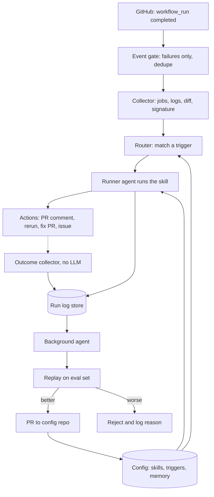

# 🚧 Under construction

# Code Triage agent

## What the system does

When a CI build fails, the **runner agent** reads the logs and decides what kind of failure it is. It then acts: re-runs a flaky test, comments on the PR with the likely cause, or opens a fix PR.

A **background agent** checks how well the runner did and edits the runner's skills, triggers and memory to improve it.

This system helps align the agent's behavior with the associated repositories conventions and styles, makes codes fixes easier to review and work better than a generic code review bot.

(This is inspired from Mintlify's self-updated documentation agent. Read more [here](https://x.com/patrickrfos/status/2116194642417037766))

## Architecture



## Development

Requires [uv](https://docs.astral.sh/uv/) (Python 3.13 is managed by uv).

```bash
cp .env.example .env   # fill in GitHub App values when testing webhooks
uv sync

make check             # ruff + mypy + pytest
make validate          # validate config/triggers.yaml, skills, memory
make serve             # http://localhost:8000/healthz
```

### Phase 1 status

The plumbing path is implemented and needs no LLM:

```bash
# Verify GitHub webhook signatures and store failures (202 in under 5s)
curl -X POST http://localhost:8000/webhooks/github ...

# Process queued events: fetch jobs/logs/diff, trim, redact, sign, snapshot
uv run code-triage-agent worker --once

# Debug one stored event, or import a raw payload for an offline run
uv run code-triage-agent collect --event-id 1
uv run code-triage-agent collect --payload tests/fixtures/github/workflow_run_event.json \
  --repo acme/widgets --run-id 9001
```

Each collected run writes `var/snapshots/<run_id>/` with `metadata.json`,
`logs.txt`, `diff.patch`, `memory.json`, and `signature.txt`. Rows for events,
runs, steps, and signatures live in `var/triage.db`.

The runner agent and PR comments arrive in Phase 2; see
[`IMPLEMENTATION.md`](./IMPLEMENTATION.md) for the ordered build plan and
[`plan.md`](./plan.md) for the system design.